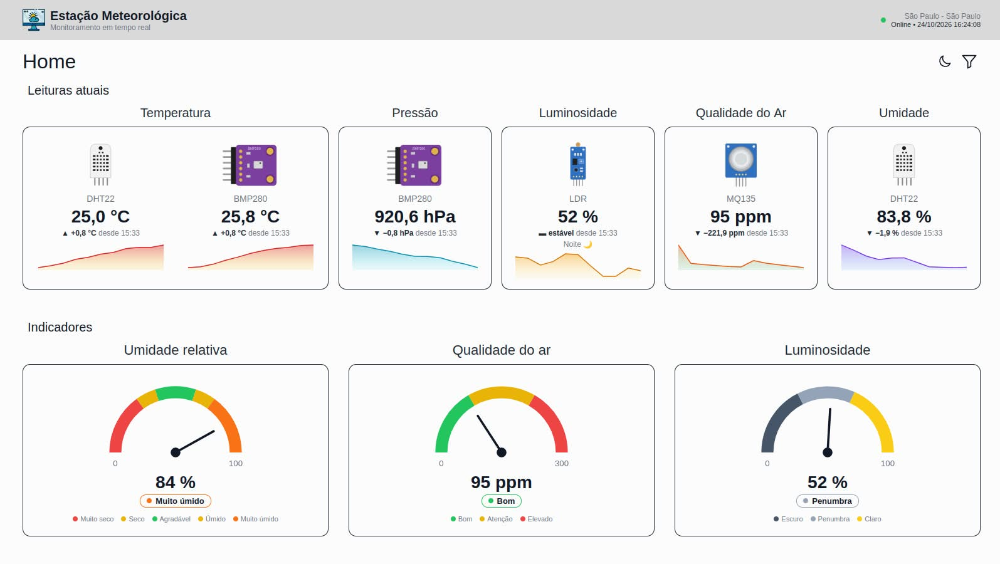
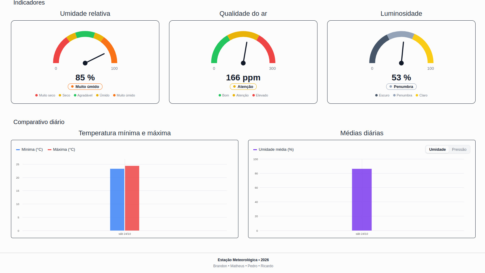
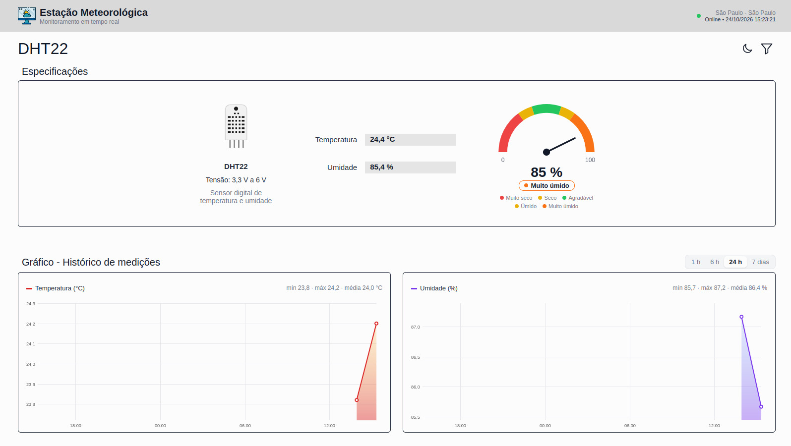
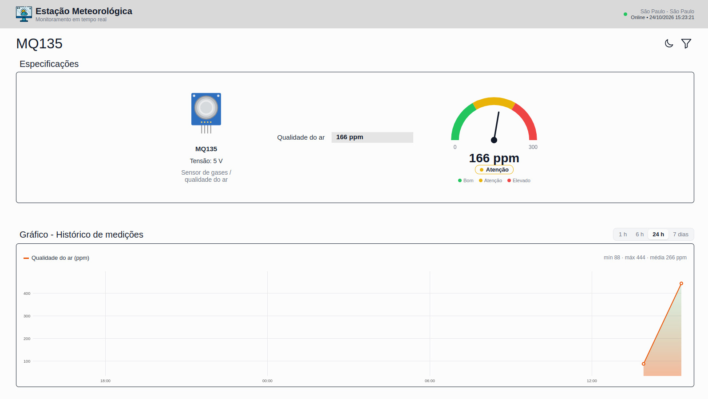
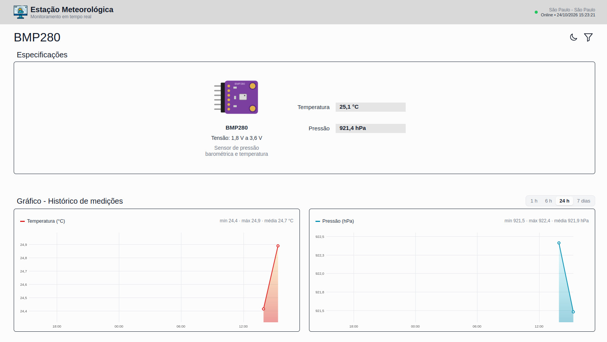
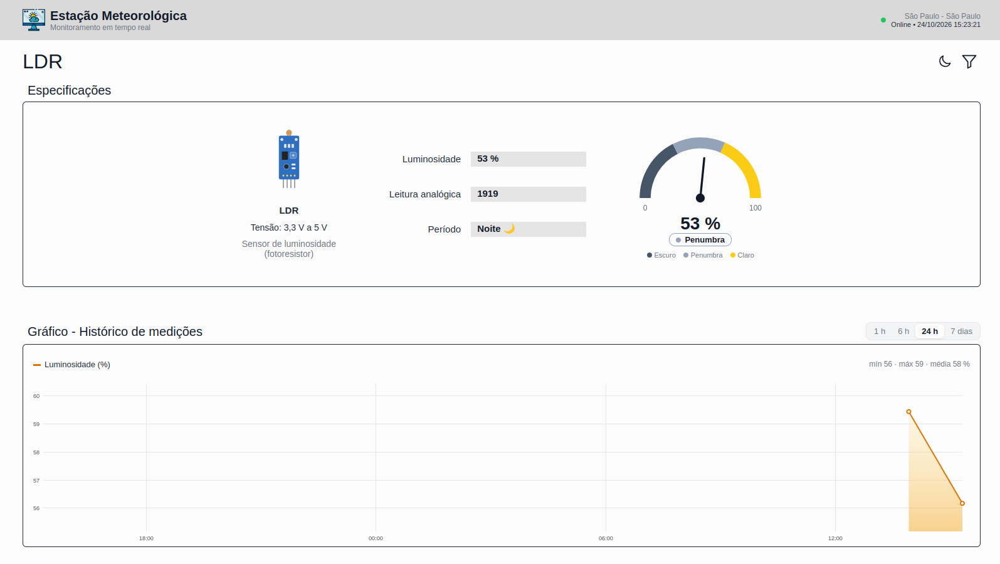
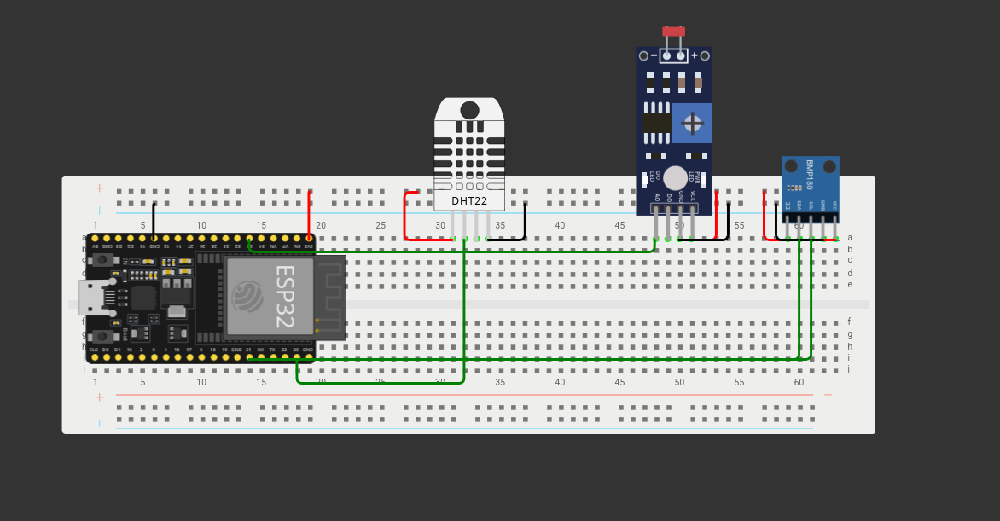

# Estação Meteorologia

Estação meteorológica embarcada que monitora condições ambientais, disponibilização dados climáticas para monitoramento em cidades inteligentes.

---

## 📌 Sobre o Projeto

O presente trabalho teve como objetivo o desenvolvimento de uma estação meteorológica embarcada destinada ao monitoramento de condições ambientais e à disponibilização de dados climáticos de forma pública e acessível.
A proposta surgiu a partir da necessidade de ampliar o monitoramento ambiental em cidades inteligentes, possibilitando que informações relacionadas às condições climáticas sejam coletadas, processadas e disponibilizadas à população em tempo real.

### 📈 Dashboard









### 🟢 Representação - Wokwi


### 🚀 Tecnologias Utilizadas

* **Linguagem:** MicroPython / JavaScript / Python 3.xx / HTML / CSS 
* **Frameworks:** Flask / FlaskMQTT 
* **Banco de Dados:** SQLite
* **Outras Ferramentas:** Thonny IDE

--- 

## 🛠️ Como Executar o Projeto 

### Pré-requisitos

*   **Placa ESP32** conectada ao computador por cabo USB de dados (cabos apenas de carregamento não funcionam).
*   **Python 3.x** instalado na sua máquina ([python.org](https://www.python.org/)).
*   **Thonny IDE** para escrever e enviar scripts ([thonny.org](https://thonny.org/)).

---

### 1. Instalar a ferramenta de gravação (esptool)
*Executado no Terminal / Prompt de Comando.*

Abra o Prompt de Comando/PowerShell (Windows) ou o Terminal (macOS) e instale o `esptool`:
```bash
pip install esptool
```

### 2. Baixar o Firmware do MicroPython
*Arquivo `.bin` para ESP32.*

1. Acesse o site oficial: [micropython.org/download/ESP32_GENERIC](https://micropython.org/download/ESP32_GENERIC).
2. Baixe a versão estável mais recente (arquivo com extensão `.bin`).

### 3. Identificar a Porta Serial do ESP32
*Varia conforme o sistema operacional.*

Conecte a placa ao computador e localize o nome da porta serial:

#### Windows
1. Pressione `Win + X` e abra o **Gerenciador de Dispositivos**.
2. Expanda a seção **Portas (COM e LPT)**.
3. Identifique a porta referente ao ESP32 (exemplo: `COM3` ou `COM4`).

#### macOS
Abra o Terminal e rode:
```bash
ls /dev/cu.usb*
```
A porta aparecerá com nome similar a `/dev/cu.usbserial-0001` ou `/dev/cu.wchusbserial...`.

> **Nota:** Se a porta não aparecer em nenhum dos sistemas, instale os drivers do chip conversor USB-Serial da sua placa (geralmente CP210x ou CH340).

### 4. Limpar a Memória Flash do ESP32
*Prepara o chip para o novo firmware.*

Execute o comando correspondente substituindo `<PORTA>` pelo identificador obtido no passo anterior:

#### Windows
```cmd
esptool.py --chip esp32 --port COM3 erase_flash
```

#### macOS
```bash
esptool.py --chip esp32 --port /dev/cu.usbserial-0001 erase_flash
```
*(Caso o processo pare em "Connecting...", pressione e segure o botão **BOOT** na placa ESP32 por 2 segundos).*

### 5. Gravar o Firmware MicroPython
*Substitua o caminho do arquivo `.bin`.*

Execute o comando de gravação ajustando a porta e o nome do arquivo baixado:

#### Windows
```cmd
esptool.py --chip esp32 --port COM3 --baud 460800 write_flash -z 0x1000 ESP32_GENERIC-20240222-v1.22.2.bin
```

#### macOS
```bash
esptool.py --chip esp32 --port /dev/cu.usbserial-0001 --baud 460800 write_flash -z 0x1000 ESP32_GENERIC-20240222-v1.22.2.bin
```

### 6. Conectar via Thonny IDE e Rodar o Código
*Ambiente de desenvolvimento recomendado.*

1. Abra o **Thonny IDE**.
2. Vá em **Ferramentas > Opções** (Windows) ou **Thonny > Preferências** (macOS).
3. Acesse a aba **Interpretador**.
4. Selecione **MicroPython (ESP32)** no primeiro menu.
5. No menu de porta, selecione a porta serial identificada anteriormente e clique em **OK**.
6. O console inferior (Shell) exibirá o prompt do MicroPython (`>>>`).

## Passo a Passo

