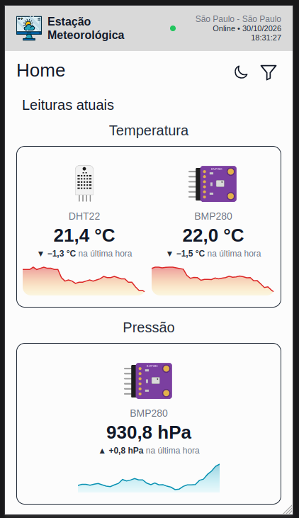
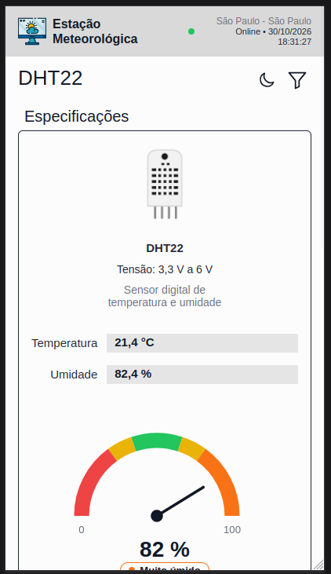
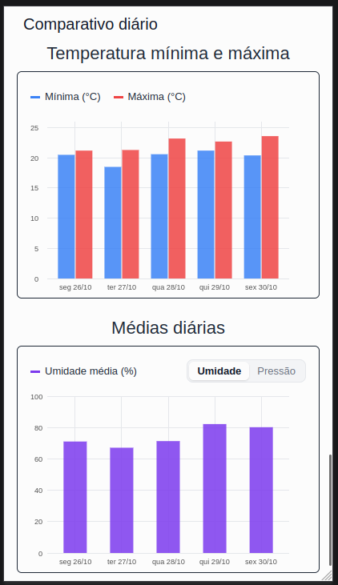

# Estação Meteorologia

Estação meteorológica embarcada que monitora condições ambientais, disponibilização dados climáticas para monitoramento em cidades inteligentes.

---

## 📌 Sobre o Projeto

O presente trabalho teve como objetivo o desenvolvimento de uma estação meteorológica embarcada destinada ao monitoramento de condições ambientais e à disponibilização de dados climáticos de forma pública e acessível.
A proposta surgiu a partir da necessidade de ampliar o monitoramento ambiental em cidades inteligentes, possibilitando que informações relacionadas às condições climáticas sejam coletadas, processadas e disponibilizadas à população em tempo real.

A estação utiliza os seguintes componentes:

| Componente | Função |
|---|---|
| ESP32 | Executar o firmware e comunicar os dados pela rede. |
| DHT22 | Medir temperatura e umidade do ar. |
| BMP280 | Medir pressão atmosférica. |
| MQ-135 | Fornecer um indicador relacionado à qualidade do ar. |
| LDR | Detectar condições de luminosidade. |

> O MQ-135 e o LDR fornecem valores brutos do conversor analógico-digital (ADC), não concentrações de gases ou valores de iluminância calibrados. A localização é aproximada e obtida pelo IP da conexão, não por GPS. O protótipo descrito não possui pluviômetro.

### 📈 Dashboard


### 📈 Dashboard - Mobile




### 🟢 Representação - Wokwi


## 🔄 Como os dados percorrem o sistema

1. O ESP32 lê os sensores e organiza os valores em uma mensagem JSON.
2. Pela rede Wi-Fi, o firmware publica a mensagem no tópico MQTT `esp32/post`.
3. O backend Flask recebe a mensagem por meio do broker, armazena os dados no SQLite e disponibiliza consultas pela API.
4. O dashboard consulta a API para apresentar indicadores, histórico, gráficos e resumos.

Na versão descrita na documentação, o firmware aguarda **300 segundos entre publicações**, enquanto a interface consulta o backend a cada **10 segundos**. A atualização da interface não significa que o sensor gerou uma nova leitura a cada 10 segundos.

## 🚀 Tecnologias utilizadas

- **Hardware:** ESP32, DHT22, BMP280, MQ-135 e LDR.
- **Linguagens:** MicroPython, Python, JavaScript, HTML e CSS.
- **Backend:** Flask, Flask-CORS e Flask-MQTT.
- **Comunicação:** Wi-Fi e MQTT.
- **Banco de dados:** SQLite.
- **Interface:** jQuery e Flot.
- **Ferramentas:** Thonny IDE e Wokwi.

## 🛠️ Como acessar e executar

As instruções abaixo apresentam a execução local do dashboard, do backend e do firmware. Para receber novas leituras, é necessário que o ESP32 esteja montado, configurado e conectado, e que o backend consiga acessar o broker MQTT.

> Não há endereço de acesso público informado neste README. A visualização sem o ESP32 pode depender dos dados existentes e da configuração da aplicação.

### Pré-requisitos

- [Git](https://git-scm.com/downloads) instalado.
- [Python 3](https://www.python.org/downloads/) e `pip` instalados no computador.
- [Thonny IDE](https://thonny.org/) para transferir e acompanhar os arquivos do ESP32.
- Placa ESP32 compatível, sensores e cabo USB com suporte a dados.
- Acesso à rede Wi-Fi e ao broker MQTT configurado no projeto.

### 1. Clonar o repositório

Abra um terminal e execute:

```bash
git clone https://github.com/brandon-ribeiro/Projeto_Estacao_Meteorologica.git
cd Projeto_Estacao_Meteorologica
```

Os comandos das próximas seções consideram que você está na pasta raiz criada pelo Git, salvo indicação diferente.

### 2. Preparar o backend

Acesse a pasta do backend e crie um ambiente virtual:

```bash
cd back
python -m venv .venv
```

No Windows, se `python` não estiver disponível, tente `py` no lugar de `python`. No macOS ou Linux, poderá ser necessário usar `python3`.

Ative o ambiente virtual conforme o sistema:

**Windows — PowerShell:**

```powershell
.venv\Scripts\Activate.ps1
```

**Windows — Prompt de Comando:**

```cmd
.venv\Scripts\activate.bat
```

**macOS ou Linux:**

```bash
source .venv/bin/activate
```

Com o ambiente ativo, instale as dependências:

```bash
python -m pip install -r requirements.txt
```

### 3. Preparar o MicroPython no ESP32

Se a placa já tiver uma versão compatível do MicroPython instalada, prossiga para a etapa 4. Caso contrário, confira o modelo exato do chip e siga as instruções de firmware correspondentes no [site oficial do MicroPython](https://micropython.org/download/).

O exemplo abaixo é destinado ao **ESP32 genérico**. Outros modelos, como ESP32-S2, S3 e C3, podem exigir outro firmware ou endereço de gravação.

1. Instale a ferramenta de gravação no computador:

   ```bash
   python -m pip install esptool
   ```

2. Baixe o arquivo `.bin` adequado ao seu modelo na página [ESP32 Generic](https://micropython.org/download/ESP32_GENERIC/), se ela corresponder à sua placa.
3. Conecte o ESP32 por USB e identifique a porta serial:
   - **Windows:** abra o Gerenciador de Dispositivos e procure em **Portas (COM e LPT)**, por exemplo `COM3`.
   - **macOS:** consulte as portas com `ls /dev/cu.*`.
   - **Linux:** consulte as portas com `ls /dev/ttyUSB* /dev/ttyACM*`.
4. Substitua `<PORTA>` pela porta encontrada e `firmware.bin` pelo caminho do arquivo baixado. Os comandos a seguir usam a sintaxe atual do `esptool`:

   ```bash
   python -m esptool --chip esp32 --port <PORTA> erase-flash
   python -m esptool --chip esp32 --port <PORTA> --baud 460800 write-flash 0x1000 firmware.bin
   ```

   **Atenção:** `erase-flash` apaga o conteúdo da memória flash da placa. Faça uma cópia de arquivos que queira preservar antes de executá-lo. Confira também as instruções oficiais para o seu modelo antes da gravação.

Se a conexão parar em `Connecting...`, algumas placas exigem manter o botão **BOOT** pressionado durante o início da conexão. Se a porta não aparecer, confira o cabo e o driver USB-serial correspondente à placa.

### 4. Configurar o Thonny e transferir os arquivos

1. Abra o Thonny e acesse **Ferramentas > Opções > Interpretador** (no macOS, acesse as preferências do Thonny).
2. Selecione **MicroPython (ESP32)** e a porta serial da placa. Confirme se o Shell apresenta o prompt `>>>`.
3. No menu **Exibir > Arquivos**, localize no computador a pasta `esp32` do repositório e visualize também os arquivos da placa.
4. Transfira para a raiz do ESP32 o `boot.py` e os demais arquivos necessários da pasta `esp32`, incluindo `bmp280.py`. No Thonny, use a opção de enviar para o dispositivo disponível no menu de contexto dos arquivos.
5. Antes de substituir o `boot.py` existente, salve uma cópia caso precise do conteúdo atual. Confirme no código quais arquivos são necessários para a execução e quais servem apenas para testes.

**Arquivos mencionados no projeto:**

- `boot.py`: arquivo de inicialização e configuração utilizado pelo projeto.
- `bmp280.py`: código necessário para o funcionamento do sensor BMP280.
- `componentes.py`: realiza verificações dos sensores e apresenta suas leituras.
- `teste_i2c.py`: auxilia na verificação da comunicação I²C e na identificação do endereço do sensor, como `0x76`.

### 5. Configurar a rede e a montagem

No `boot.py`, preencha as variáveis correspondentes à sua rede Wi-Fi:

```python
SSID = ''      # Nome da rede Wi-Fi
PASSWORD = ''  # Senha da rede Wi-Fi
```

A documentação informa a seguinte pinagem do firmware:

| Componente | Interface | Pinos e configuração |
|---|---|---|
| DHT22 | Digital | GPIO 23 |
| BMP280 | I²C | SCL: GPIO 22; SDA: GPIO 21; endereço `0x76`; frequência de 10 kHz |
| LDR | ADC | GPIO 35; atenuação `ATTN_11DB` |
| MQ-135 | ADC | GPIO 34; atenuação `ATTN_11DB` |

A tabela indica os sinais declarados no firmware. Confira também alimentação, terra comum, tensão dos módulos e ligações da montagem antes de energizar o circuito; não aplique ao ESP32 sinais acima da tensão permitida.

A configuração MQTT descrita no projeto é:

| Configuração | Valor |
|---|---|
| Broker | `broker.emqx.io` |
| Porta | `1883` |
| Publicação de leituras | `esp32/post` |
| Recebimento de comandos | `esp32/get` |
| Keepalive | 60 segundos |

O broker é público e a configuração documentada não utiliza autenticação nem TLS. Os tópicos são compartilháveis: outras pessoas podem publicar ou ler mensagens neles. Para uso além da demonstração, configure broker protegido, autenticação, TLS e tópicos próprios no ESP32 e no backend. O firmware descrito usa um identificador de cliente fixo; placas simultâneas devem usar identificadores únicos.

O firmware também importa `urequests` e `umqtt.simple`. Confira se esses módulos estão disponíveis no MicroPython da placa; as dependências instaladas com `pip` no computador não são automaticamente instaladas no ESP32.

> Não publique senhas nem outras credenciais no repositório. Antes de compartilhar o código, remova os dados da sua rede.

### 6. Iniciar o backend

No terminal em que o ambiente virtual foi ativado, ainda dentro da pasta `back`, execute:

```bash
python app.py
```

Mantenha esse terminal aberto. Consulte as mensagens exibidas para verificar a inicialização do backend e a conexão MQTT. Na configuração descrita na documentação, o dashboard consulta a API em `http://127.0.0.1:5000`. Se alterar o endereço ou a porta do backend, atualize também a configuração do frontend.

### 7. Iniciar o ESP32

Com o backend em execução, reinicie a placa ou execute o arquivo de inicialização no Thonny, de acordo com o funcionamento do firmware. Acompanhe o Shell para conferir a conexão Wi-Fi, a conexão MQTT e eventuais mensagens de erro.

As leituras só chegarão ao backend se o ESP32 e o backend estiverem configurados para usar um broker e tópicos MQTT compatíveis.

### 8. Abrir o dashboard

Abra **outro terminal**, acesse a raiz do repositório e execute:

```bash
cd front
python -m http.server 8000
```

Abra [http://localhost:8000](http://localhost:8000) no navegador. Se a página principal possuir outro nome que não seja `index.html`, acrescente o nome do arquivo à URL. Mantenha os dois terminais abertos durante o uso.

## 🌐 Rotas da API

Com o backend ativo e configurado na porta 5000, as rotas de consulta podem ser acessadas no navegador:

| Método e rota | Finalidade |
|---|---|
| `GET /dados` | Retorna a última leitura classificada como dados de sensores. |
| `GET /historico?limite=10` | Consulta o histórico, com opção de limitar os resultados e filtrar por tipo. |
| `GET /historico/periodo?horas=3&pontos=60` | Consulta médias por intervalo, relativas à última leitura armazenada. |
| `GET /resumo/diario?dias=7` | Consulta resumo diário das leituras. |
| `POST /comando` | Publica um comando em `esp32/get`. No firmware descrito, o recebimento é exibido no terminal. |

Por exemplo, acesse [http://127.0.0.1:5000/dados](http://127.0.0.1:5000/dados) para consultar a última leitura. O conteúdo retornado depende dos dados disponíveis no banco.

## 💾 Armazenamento e limitações

O backend registra o payload original em `leituras` e organiza os dados em tabelas relacionadas: `dht_leituras`, `bmp_leituras`, `ldr_leituras`, `mq_leituras` e `gps_leituras`. Apesar do nome da última tabela, a localização documentada é obtida por IP.

A documentação relata testes locais de quatro rotas GET e uma inserção sintética em banco isolado. Esses ensaios não comprovam operação contínua, desempenho em rede nem calibração dos sensores. Ela também registra que a aplicação não valida fisicamente as faixas de medição antes da gravação. A localização é aproximada e a instalação do frontend e backend em um computador não torna o dashboard público automaticamente.

A pausa de 300 segundos entre envios supera o keepalive configurado de 60 segundos; a estabilidade da conexão e o recebimento de comandos requerem testes adicionais e revisão da rotina de comunicação.

## 🔎 Problemas comuns

- **A porta serial não aparece:** confira se o cabo transmite dados, verifique o driver USB-serial e tente outra porta USB.
- **O ESP32 não se conecta ao Wi-Fi:** confira o nome e a senha da rede e a compatibilidade da rede com a placa.
- **O backend não recebe dados:** confira a conexão com o broker, os tópicos MQTT configurados e as mensagens nos terminais do backend e do ESP32.
- **O dashboard abre sem dados:** confirme se o backend está ativo, se a interface aponta para o endereço correto da API e se há leituras disponíveis.
- **Os sensores não respondem:** confira a alimentação, os pinos GPIO, as conexões e as mensagens do Shell. Para o BMP280, utilize `teste_i2c.py` para auxiliar no diagnóstico.
- **O servidor web não inicia:** verifique se a porta `8000` já está em uso; se necessário, escolha outra porta no comando e use a mesma porta no navegador.

## 👥 Colaboradores

- Brandon Gabriel Consoli Ribeiro
- Luiz Ricardo Bandeliauskas de Castro
- Matheus Henrique da Silva Anunciação
- Pedro Henrique Silva Pimentel

Projeto desenvolvido no curso de Ciência da Computação da Universidade Paulista — UNIP.
